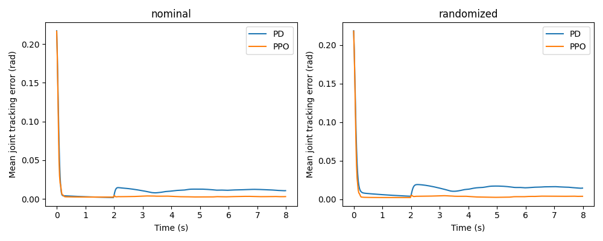
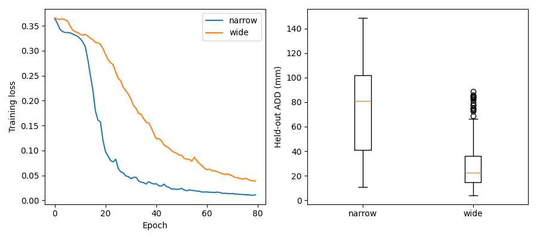

I built a simulated lab pipetting robot because I wanted a way to check plate motion and failure recovery without a physical robot. It moves a pipette over a 96-well plate, visits the wells I choose, and records where the three moving axes actually went compared with where I asked them to go.

This is a **simulation**, with no hardware connection. Each dispense is a recorded event with a well name and volume; it does not simulate liquid flow or prove dispensing accuracy. The robot lifts before moving sideways, lowers at each well, records the dose, and lifts again. I can also teach named positions by jogging the robot, replay a small program, wait for a simulated sensor, and switch a simulated output. I use this to check a motion sequence around fixed equipment before putting it into a plate routine. I can cancel a run or trigger an emergency stop to check how it stops.

When a plate run stops, I can read its fault report and replay supported injected faults in a separate simulator. The report keeps the exact message and nearby motion measurements, and links to [operator playbooks](docs/playbook/). A separate C++ monitor watches the measured joint travel and speed. I also use generated camera images and depth scans to explore part inspection and alignment, and a small two-axis arm to compare learned control with a conventional controller. These are experiments in simulation, with no claim of physical robot accuracy.

To inspect one of my recorded Gazebo stops without starting ROS or installing anything extra:

```sh
python3 tools/triage_example.py
```

That prints the exact emergency-stop message, its fault group and nearby measured joint positions from a CI run. `--fault limit_switch` selects the other recording. Both original runs and their successful replays are [committed with their provenance](docs/results/runs/).

For a small example without ROS or a simulator, I can generate labelled part images and inspect them:

```sh
python3 -m venv .venv
. .venv/bin/activate
pip install './experiments[vision]'
python -m gantry_lab.inspection --output output/inspection
```

This writes millimetre measurements, pass/fail checks, robot guidance offsets and the measured error rates. [The experiment guide](docs/experiments.md) explains how to align scans, process depth, train the arm controller and render parts for pose learning. [The pendant design](docs/ui/) shows the jog, teach and run screens in an editable Penpot file. For motion and fault reproduction, I use the full Linux simulation below.

To try it, install Docker with a running Linux container engine, then run:

```sh
git clone https://github.com/jackaI1/ros2-lab-gantry.git
cd ros2-lab-gantry
docker build -t lab-gantry .
mkdir -p logs
docker run --rm --name gantry-demo -v "$PWD/logs:/logs" lab-gantry \
  /ws/tools/demo.sh --wells A1 A2 B2 --volume 50
```

The first build downloads the robot software and can take several minutes. The demo runs without a window, prints each motion phase, saves CSV files in `logs/`, and stops the simulator when it finishes. `--volume` is in microlitres, up to 200 per well. Wells run in the order supplied, from A1 through H12. Duplicate wells and invalid volumes are rejected before motion.

## What I can inspect

Each run produces two files with a shared random run identifier:

- `*-dispenses.csv`: the wells actually reached, requested volumes, and a flag saying the dispense was simulated. A dose counts after lowering finishes, even if a later retract is interrupted.
- `*-tracking.csv`: simulation time, well, motion phase, joint, requested position, measured position, and signed error in metres. Error is requested minus measured position, rather than distance from the final destination.

I use the tracking file to see lag during a move and check whether the robot settles at a well. These are simulation measurements, not calibration results for a real machine.

## Run it interactively

ROS 2 passes messages between the simulator, controller, and protocol runner. An action is a request that reports progress and can be canceled. To leave the simulation running for experiments:

```sh
docker run --rm -it --name gantry-sim -v "$PWD/logs:/logs" lab-gantry \
  ros2 launch gantry_control simulation.launch.py log_dir:=/logs
```

In another terminal:

```sh
docker exec gantry-sim /ws/tools/entrypoint.sh \
  ros2 run gantry_control run_plate --wells A1 H12 --volume 25

# Trigger the simulated emergency stop while a protocol is moving.
docker exec gantry-sim /ws/tools/entrypoint.sh \
  ros2 service call /gantry/emergency_stop std_srvs/srv/SetBool '{data: true}'

# Clear the input, then explicitly reset the latched fault.
docker exec gantry-sim /ws/tools/entrypoint.sh \
  ros2 service call /gantry/emergency_stop std_srvs/srv/SetBool '{data: false}'
docker exec gantry-sim /ws/tools/entrypoint.sh \
  ros2 service call /gantry/reset_fault std_srvs/srv/Trigger '{}'
```

`/gantry/limit_switch` has the same boolean service interface for testing a switch trip. `/gantry/fault` reports the current fault or `OK`. Stop the interactive simulator with Ctrl-C or `docker stop gantry-sim`.

For the raw action interface, including feedback:

```sh
docker exec gantry-sim /ws/tools/entrypoint.sh \
  ros2 action send_goal /gantry/run_protocol gantry_interfaces/action/RunProtocol \
  '{wells: [A1, B2], volume_ul: 50.0}' --feedback
```

## Teach a motion sequence

I use the command-line pendant, a set of controls for moving the robot and remembering positions. A taught point is a named location captured from the robot's measured position. I can add a small offset, an adjustment in metres, without changing the original location.

Start the interactive simulator above. From another terminal, copy the example program into the container and teach its two locations:

```sh
docker cp examples/taught-cycle.json gantry-sim:/tmp/cycle.json
# The commands below run inside the simulator container.
docker exec -it gantry-sim /ws/tools/entrypoint.sh bash
ros2 run gantry_control pendant mode teach
ros2 run gantry_control pendant jog joint 0.005 0 0
ros2 run gantry_control pendant jog world 0 0.005 0
ros2 run gantry_control pendant jog tool 0 0 0.005
ros2 run gantry_control pendant record approach --frame world
ros2 run gantry_control pendant jog tool 0 0 0.010
ros2 run gantry_control pendant record dispense --frame tool --offset 0 0 0.001
ros2 run gantry_control pendant status
```

The three frames are directions for interpreting a move. **Joint** follows the three slides, with positive Z going down. **World** follows the room, with positive Z going up. **Tool** follows the fixed pipette: X points along world X, Y points opposite world Y, and Z points down the tip. The pipette cannot rotate, so tool orientation stays fixed. Each jog is limited to 10 mm per axis.

Teach mode runs one instruction I select, at up to 10 mm/s. Auto mode runs the whole program, at up to 40 mm/s. Instructions are numbered from zero:

```sh
# Still inside the container: try only the approach move in teach mode.
ros2 run gantry_control pendant run /tmp/cycle.json --step 1
# Auto waits at instruction zero until I simulate a ready sensor.
ros2 run gantry_control pendant di 0 true
ros2 run gantry_control pendant mode auto
ros2 run gantry_control pendant run /tmp/cycle.json
ros2 run gantry_control pendant status
exit
```

The program waits for digital input 0 (a simulated on/off sensor), visits the approach and dispense points, turns digital output 1 on, retracts, then turns it off. Outputs are simulated on/off signals, not a pump or a physical controller. I can leave input 0 false to see the program wait, then change it from another terminal. Ctrl-C cancels a running program and leaves output values at their last programmed settings; normal cancellation does not need a fault reset. The emergency-stop and reset commands above work in both modes, including during an input wait. An emergency stop or a latched fault turns all outputs off and requires an explicit reset after I clear the input. Clearing the stop never resumes motion.

Points stay in the running server until it stops. Duplicate names are rejected; `pendant delete dispense` removes a point so I can teach it again. Point offsets use the frame chosen when recording. A move can add another offset in that same frame. I keep the JSON instruction file separately so the sequence is repeatable after teaching.

A red fixed tool stand occupies the far corner of the simulated work area. Before moving, I check the entire straight path against an interference zone around that stand, including clearance for the pipette body. Clear endpoints alone are not enough. I must teach a raised approach to go over it. Auto checks the whole program before any output changes, and all motion is checked again against current measured positions. The plate runner uses the same check and the same motion slot, so it cannot run alongside the pendant. See [the pendant reference](docs/pendant.md) for the program format and boundaries.

## Work backwards from a stop

For every plate request, the server saves the original request and initial position in `*-run.json`, plus input changes and latched faults in `*-events.jsonl`. These share the tracking CSV's run identifier. Inside the Linux simulation environment:

```sh
python3 -m gantry_control.triage /logs/<run-id>-run.json > /logs/report.md
python3 -m gantry_control.replay /logs/<run-id>-run.json --simulation
```

The report groups complete known messages and leaves unfamiliar messages in an unknown group. It includes the 12 nearest tracking samples before each event. Replay restores the starting position, runs the original plate request and reapplies recorded emergency-stop or limit-switch inputs through the real services. It checks whether the new run reaches the same fault group. Other failure types require manual reproduction; the tool refuses to invent a matching fault. I only replay in an isolated Gazebo session with no hardware connection. See [the triage guide](docs/triage.md).

Each [playbook page](docs/playbook/) gives symptoms, checks, fixes and a recovery check. CI rejects stale pages whenever the reviewed signature catalog, control code, controller parameters or C++ limit logic changes. The C++ node publishes an advisory stop request and warning from actual joint measurements; the Python server remains responsible for its own latched stops. This is not a certified safety controller.

## How I arranged the robot

The URDF, an XML description of the robot's parts and joints, defines three sliding axes: X travels 220 mm, Y travels 160 mm, and Z travels 80 mm downward. Gazebo Harmonic runs the model's physics. The `gz_ros2_control` plugin connects its measured joint positions to `ros2_control`, which provides the controller interface. A position-based trajectory controller follows timed moves for all three joints together.

My protocol server sends each lift, sideways move, lower, and retract as a separate controller action. It only records a simulated dispense after the lower action succeeds. A plate has 9 mm well spacing, with A1 at X = 40 mm and Y = 35 mm. Travel uses Z = 10 mm; dispensing uses Z = 60 mm. All plate and pendant moves use a trapezoidal speed profile: accelerate, travel at steady speed, then slow to a stop. Short moves use a triangular profile with no steady-speed section. The axes move together along a straight path, with acceleration limited to 80 mm/s².

The server rejects overlapping runs and watches measured positions for six end-of-travel switches. It also latches an emergency stop, an injected limit switch, stale controller feedback, and sustained tracking error. A fault cancels the active trajectory and prevents another protocol until the fault input is clear and I reset it. A wall-clock watchdog still runs when simulation time stops. More detail, including the boundaries of this stop behavior, is in [the design notes](docs/design.md).

## What I measured in the experiments

On 100 generated part images, the inspector passed all 20 good parts and rejected all 80 defective or absent parts. Three generated room scans aligned with recovered pose errors below 0.40 mm in that run. These results are for known synthetic scenes, not real camera or laser-scanner accuracy.

I trained the two-axis arm controller for 200,192 steps and compared it with tuned PD control over 20 shared evaluation seeds. PPO averaged 0.0174 rad tracking error versus 0.0207 rad for PD under nominal physics. I also measured settling time, confidence intervals and the effect of changed mass and friction.



For full part pose, I rendered 1,152 labelled images in Blender and trained two small image models. Wide training variation reduced mean held-out model-point error from 74.2 mm to 31.1 mm. Only 55 of 128 wide-model estimates were below the experiment's 20 mm threshold. This is a useful generalization comparison, but the pose estimates are not accurate enough for robot placement.



[The measured reports](docs/results/) include every seed, failure breakdowns and the producing CI runs. The [experiment guide](docs/experiments.md) gives exact commands and explains each metric.

## Find the plate with the camera

Fixed well coordinates break as soon as a plate sits a few millimetres away from where I taught it. So I added a simulated camera above the work area. It looks straight down at the plate and sends an image every fifth of a second.

A small neural network reads each image and estimates how far the plate has moved sideways and how far it has turned. The network is a PyTorch model, which means it learns the mapping from examples instead of from rules I wrote by hand. I trained it on about 1,200 synthetic camera frames per epoch, each with different lighting, plate position, a slight tilt, and sometimes a missing or half-covered plate.

The protocol then visits the wells at the corrected position. When the camera is unsure, the run uses the taught position instead and the printed message says why. The camera has to agree with itself over five frames before I trust it, so one bad frame does not move the robot.

Start the simulator with the camera world:

```sh
docker run -d --rm --name gantry-vision -v "$PWD/logs:/logs" lab-gantry \
  ros2 launch gantry_control simulation.launch.py vision:=true log_dir:=/logs
```

Wait about a minute for it to start. Then ask the camera where the plate is, without moving the robot:

```sh
docker exec gantry-vision /ws/tools/entrypoint.sh \
  ros2 run gantry_control plate_guide --once --wells A1 H12
```

It prints one line such as `plate pose from camera: x=0.41 mm y=-0.22 mm yaw=0.03 deg (frames agree)`, or `plate pose from taught: ...` with the reason. To run a protocol at the position the camera sees, leave out `--once` and give the wells and volume:

```sh
docker exec gantry-vision /ws/tools/entrypoint.sh \
  ros2 run gantry_control plate_guide --wells A1 B2 --volume 50
docker stop gantry-vision
```

To train the detector yourself, or to see its measured accuracy, use the separate `vision` folder. It renders the scenes, trains, scores 300 held-out scenes that are different from the training scenes and that move the plate about 40% further, and writes an ONNX file, which is a standard format that any runtime can load:

```sh
python -m venv .venv && . .venv/bin/activate
pip install './vision[learning]'
python -m gantry_vision.train --output output/vision --epochs 20 --samples 1500
```

METRICS_PLACEHOLDER

The training images come from a renderer that uses the same camera pose and lens as the Gazebo camera, not from Gazebo's own renderer. Gazebo is too slow for thousands of lighting and plate-position changes in a CI job, so I render the training frames separately and check the live camera in the simulator. [The design notes](docs/vision.md) describe the decision rules, the labels and the limits. The detector has only seen synthetic images, so it has not been tested on a real camera.

## Tests and CI

```sh
docker run --rm --name gantry-test lab-gantry /ws/tools/test.sh
```

The test suite builds and runs the real Gazebo model. The Python control cases check plate geometry, safe move ordering, invalid inputs, all axis limits, frame directions, point offsets, full-path tooling checks, and speed and acceleration limits. Eleven launch cases bring up the full system and check a two-well run, measured motion and tracking CSVs, cancellation, overlapping goals, emergency stop, injected and position-derived limit trips, recovery, paused-simulator feedback loss, measured pendant jogging and replay, teach stepping, digital input waits, digital outputs, E-stop in both pendant modes, and rejected unsafe programs.

GitHub Actions builds the Docker image and runs the same tests on Linux for pull requests and commits to `main`. I keep the container headless so the tests need neither a display nor a GPU. The ROS build runs 66 Python control and transport cases, four GoogleTest cases and eleven Gazebo launch cases. The detailed test count and measured tracking results are recorded in [validation](docs/validation.md).


The separate perception and learning workflow runs 80 Python cases for the existing control logic, geometry, inspection and documentation contracts, plus eight learning and pose-math cases. It checks known-transform registration and loop closure, a headless PPO training run with a 20-seed PD comparison, and real Blender rendering followed by two pose-model training runs. It also creates the native Penpot design in a disposable instance, exports and reimports it, tests its clickable flow, and checks all 20 action mappings against the working server. I keep the measured reports and plots in [the experiment results](docs/results/) and the full run evidence in GitHub Actions artifacts. Generated scans and images are labelled as synthetic throughout.
