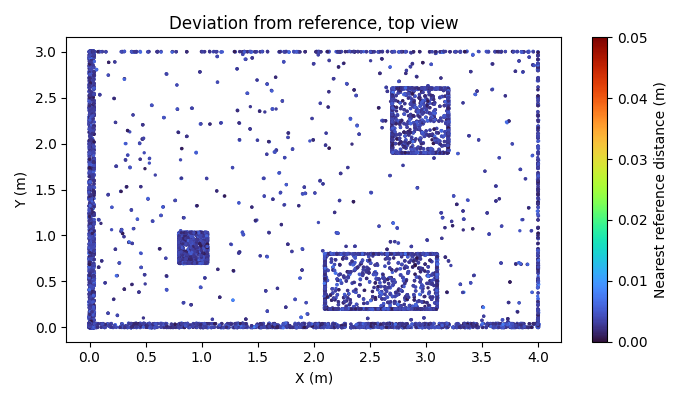
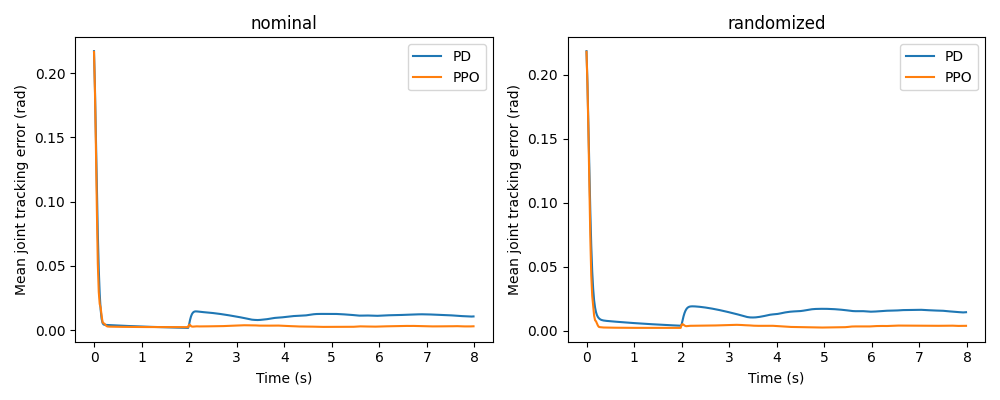

# What I measured

I keep these small reports so I can inspect a result without installing the simulation. Each JSON report links its producing GitHub Actions run and the source revision. The full images, clouds, trained weights and detailed trajectories stay in that run's artifacts. These are generated scenes and simulated motion, not hardware accuracy measurements.

## Scan alignment and depth

The three room-scan pairs had fitness between 0.971 and 0.975, where one means every downsampled source point found a nearby match. Matched-distance RMSE was 13.8 to 14.0 mm. After loop-closure optimization, the two moved scan poses were within 0.40 mm and 0.011 degrees of their known poses. These metrics measure different things: sampling and noise affect point-to-surface distance even when the recovered camera pose is close.

[The registration report](registration.json) contains all three transforms, pair metrics and pose errors. The merged cloud's mean nearest-reference deviation was 3.19 mm and its 95th percentile was 5.56 mm.

For the depth-bin experiment, I ran five seeds per condition. Success means under 15 mm translation error and 15 degrees rotation error against ground truth.

| Condition | Successful estimates |
| --- | ---: |
| Clean depth | 4/5 |
| 1 mm noise | 5/5 |
| Noise and 20% missing depth | 5/5 |
| Noise, missing depth and a contiguous occlusion stripe | 3/5 |

[The depth report](depth.json) keeps every estimate, including the large orientation errors under occlusion. Noise did not make the problem harder on every seed; a small, partly planar shape can have ambiguous feature matches even in clean data. These 20 trials are a debugging sample, not a population-level accuracy claim. [One compressed depth image](../../examples/depth/) is committed with its known pose so I can process the same measurements again.

## Image inspection

On 100 labelled generated images, the inspector passed all 20 good parts and rejected all 80 defective or absent parts. That is 0/80 false passes and 0/20 false fails. The camera calibration's corner reprojection RMSE was 0.352 pixels. [The inspection report](inspection.json) includes every label, pass/fail check, dimension measurement and guidance offset. This checks a fixed planar camera setup; it does not establish real lens calibration or manufacturing accuracy.

## Learned tracking

I trained PPO for 200,192 physics-control steps with mass and friction randomization. I selected PD gains on four separate tuning seeds, then evaluated both controllers on the same 20 new seeds. The table shows mean tracking RMSE with 95% bootstrap confidence intervals across those seeds, in radians.

| Physics | Tuned PD | Trained PPO |
| --- | ---: | ---: |
| Nominal | 0.02065 [0.01836, 0.02318] | 0.01738 [0.01467, 0.02030] |
| Randomized mass and friction | 0.02406 [0.02150, 0.02655] | 0.01863 [0.01585, 0.02143] |

PPO's nominal mean error was 15.8% lower than PD's in this run. The paired PPO-minus-PD difference was -0.00327 rad, with a 95% interval of [-0.00373, -0.00285]. All 20 trials settled for each controller in each domain. Nominal mean settling times were 0.131 s for PD and 0.110 s for PPO; changed physics increased them to 0.153 s and 0.127 s. Randomization increased mean tracking error by 0.00341 rad for PD and 0.00125 rad for PPO.

[The learning report](lamp.json) records the gains, seeds, confidence intervals and each trial. This small arm has gravity disabled, a simple target family and limited parameter variation. The comparison supports this experiment only; it does not show that reinforcement learning is generally better than conventional control.
